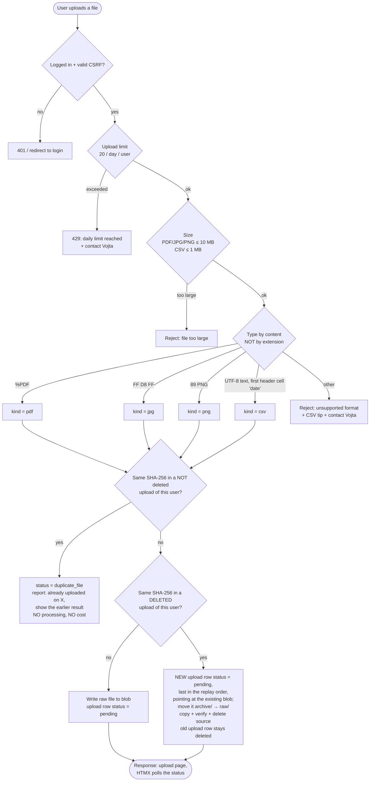
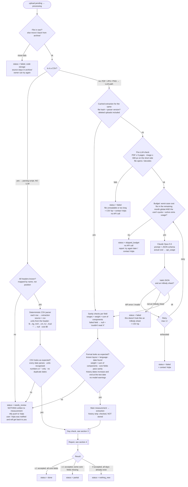
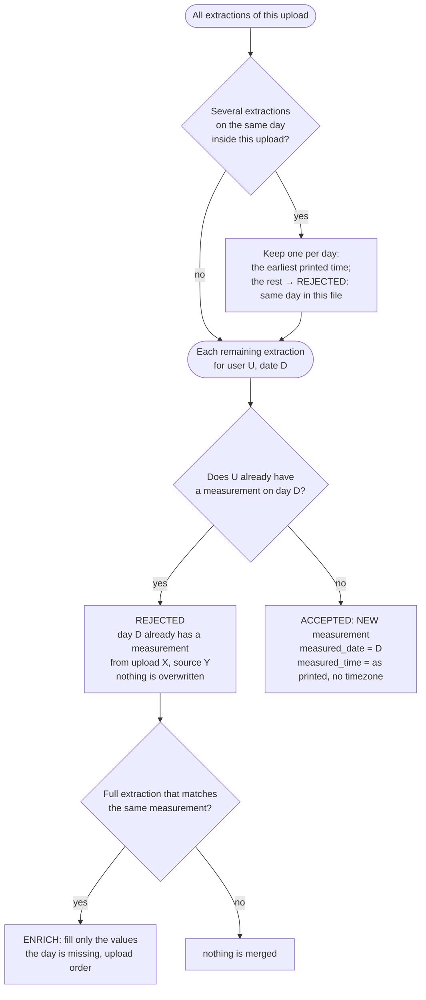
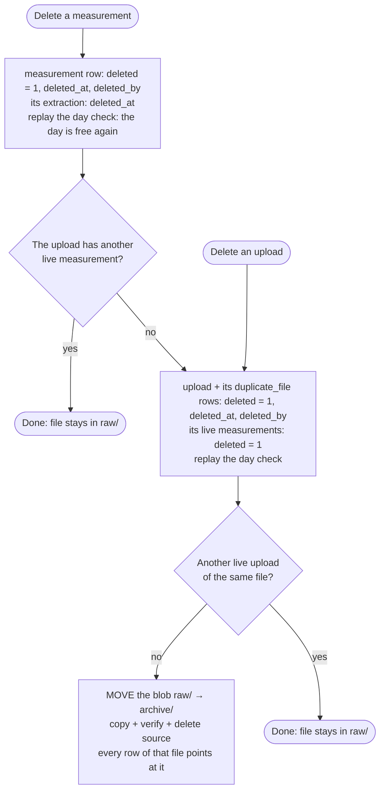

# Upload pipeline: what happens after a file is uploaded

This is the spec for the upload decision logic. Code and tests have to match it; when the
logic changes, change this file in the same commit.

Principles:
- **Blob = source of truth.** Blob holds only the raw files (`raw/<user>/<yyyy-mm>/<uuid>-<name>`),
  **one blob per user and SHA-256**. While no live upload references a file it sits in
  `archive/<user>/<yyyy-mm>/<uuid>-<name>` (section 7). SQL (`upload`, `extraction`,
  `measurement`, `api_usage`) can be rebuilt from the live files in `raw/` at any time with
  `rebuild-index` + `reprocess`; deleted data (in `archive/`) never comes back by itself.
- **Deleting never deletes anything** (section 7): no SQL row is removed and no file is
  hard-deleted. Rows get `deleted = 1`; a file moves to `archive/`.
- **CSV is deterministic and free. PDF/JPG/PNG go through Claude Opus 5.5** with a hard spend limit
  ($50/month globally + a per-user monthly quota of $5 for everyone, plus optional **extra usage** grants per user: an amount valid for a period, default from today for 7 days, granted from the backend CLI `scripts/users.py grant-extra`; no admin UI. Spend is charged to the monthly quota first, then to active grants, soonest-expiring first. The global cap applies on top of everything).
- **One measurement per user per DAY. First come wins.** The time printed in a source is unreliable
  (the InBody app sometimes drops PM), so it is not used for matching. The measurement is stored
  as `measured_date` (DATE) + `measured_time` (TIME as printed, informational only), with **no
  timezone**. If the user already has a measurement on that day, the new one is **REJECTED**
  and nothing is overwritten. **Enrichment (user decision 2026-11-17):** a rejected FULL extraction
  that looks like the same measurement still fills the values the day's measurement is missing
  (NULL), never replacing a value that is already there (section 3).

## 1. Admission (synchronous, before the user gets a response)

## 2. Processing (background in the app; pending uploads resume after a restart)

**Be defensive.** When the format doesn't look as expected, the pipeline does not guess and does
not save a "best effort" result. It stops in `needs_review` and asks Vojta (section 6). A wrong
number in someone's history is worse than a day's delay.

**The sheet's history strip is not stored** (decided 2026-11-16). Its dates are still checked
(they must increase and end at the test date), but its partial points never become
measurements: by first-come-wins they would block a later full measurement (e.g. from the CSV)
on the same day. Only the sheet's main measurement is stored.

## 3. Day check: one measurement per user per day

- Matching uses **only the date**. The time is stored as printed and used only for display and for
  ordering within a day; it is never converted.
- The extraction row is always kept (with `accepted = false` and the reason), so the report and
  `reprocess` are reproducible. `measurement` holds only accepted rows.
- **Rebuild order:** `measurement` is rebuilt deterministically by replaying all extractions of the
  user in upload order (`upload.created_at`, then the rule above inside an upload). The same input
  therefore always gives the same result, and "first come wins" survives a `reprocess`.
- **Enrichment** (changed 2026-11-17 at the owner's request; this is a deliberate change of the
  earlier "no merge" rule): when a later upload's extraction is REJECTED `day_exists`, it is a full
  extraction (not a history point), not deleted, and it **matches the day's measurement** -- at least
  one of weight, skeletal muscle mass, body fat mass, total body water, percent body fat is printed
  in both and every such pair agrees within 2 % -- then every value the day's measurement lacks
  (NULL) is filled from it, in upload order. A value that is already there is never replaced.
  Provenance, device, source name, printed time, `origin` and parser details stay those of the
  first measurement. The extraction itself stays `accepted = false, day_exists`; its report item
  lists the filled fields (`enriched`), and its upload status is `done` instead of `nothing_new`
  when it added something. Enrichment is part of the deterministic replay: `reprocess` /
  `rebuild-index` and any delete recompute it, so deleting the donor file removes what it added.
  A file that does not match (another measurement on the same day) is not merged.
- Consequence: what arrives first for a day wins (its values stay, only gaps are filled from later
  files). Re-uploading a better source (e.g. a CSV after a screenshot) does not replace that day,
  but it completes it. To replace one, the owner deletes that measurement (or its
  upload) and uploads again.
- **Deleted extractions are skipped** (reason `deleted`): an extraction whose measurement the
  owner deleted (`extraction.deleted_at`, kept across a `reprocess`), or any extraction of a
  deleted upload. So after a delete the next upload in line for that day takes it.
- `measurement` keeps a deleted measurement's row with `deleted = 1`. The replay rewrites only the
  LIVE rows (one per user and day: a filtered unique index on `deleted = 0`); a deleted row comes
  back to life only when its extraction is accepted again (`restore`).

## 4. Report to the user (CS/EN, stored with the upload in SQL)

| Section | Content |
|---|---|
| **What we found** | number of measurements, dates/times, source type, detected device/gym; per measurement which core metrics came in (weight, SMM, fat, PBF, BMI, BMR, visceral fat, segmental, impedance, InBody score) |
| **What's missing** | core fields that stayed null + fields that failed sanity checks ("couldn't read X") |
| **Matching** | per measurement ACCEPTED (new day) or REJECTED (the day already has a measurement: from which earlier upload and source, on which date; or the same day appears twice in this file) |
| **CSV tip** | only for a non-CSV upload: the CSV export from the InBody app is the best source (exact, full history, no AI cost) |
| **Contact** | always; prominent on `failed` / `skipped_budget` / `partial`: "If something looks wrong, contact Vojta" (mailto `CONTACT_EMAIL`, subject with the upload id). On `needs_review` and `failed`: **"Vojta was notified and will get back to you."** |

## 5. Progress bar on the upload page

Three phases, shown in order as one bar split into three segments. **Every phase stays visible
for at least 1 s**, even when it finishes faster (the client queues transitions), so the whole
bar takes at least 3 s.

| Phase | What happens | Estimate (initial default) | Progress inside the phase |
|---|---|---|---|
| **1. Storing raw data** | upload from the browser + blob write + `upload` row | by size: ~1 s + upload time | **real**: XHR `upload.onprogress` (bytes), then blob write |
| **2. Parsing data** | CSV: deterministic parser. PDF/JPG/PNG: budget check + Claude call + validation | CSV: 1 s · image: 30 s · PDF: 25 s + 10 s/page · cache hit: 1 s | **estimated**: time-based curve toward 95 % of the estimate, never reaching 100 % before the server says the phase is done; past the estimate it shows "taking longer than usual…" |
| **3. Saving data** | day check, write accepted measurements, report | 1 s | estimated, like phase 2 |

- The server stores `phase` + `phase_started_at` on the `upload` row (and the actual durations of
  every phase). The page polls with HTMX every 1 s; between polls, a small script animates the bar
  locally.
- **Estimates learn:** the default from the table is replaced by the median actual duration of the
  last 20 uploads of the same kind (for PDF per page), once there are at least 5.
- A cached extraction (same hash + parser version) has parsing ~1 s. Nothing on the page says the
  answer came from the cache.
  `duplicate_file`: after phase 1 the bar ends with "already uploaded on X".
- Failure: the bar stops at the phase where it failed, turns red, and the message + contact for
  Vojta is shown below it. `skipped_budget` = stops in phase 2 in amber.
- Accessibility: `role="progressbar"` + `aria-valuenow`, text phase name + "about N s left";
  `prefers-reduced-motion` = no animation, just steps.

## 6. Review queue and notifications to Vojta

**ntfy push** (same pattern as the monorepo, memory `ntfy-phone-push`): `POST https://ntfy.sh/<topic>`.
- Topic `vh-inbody-<8 hex>`. **The topic is a credential**: its value lives only in the Container App
  secret `ntfy-topic` (env `INBODY_NTFY_TOPIC=secretref:ntfy-topic`) and locally in the gitignored
  `.apikeys/ntfy.env`, never in the repo or in memory. Empty topic = push off (tests, local dev).
- Sent on: `needs_review`, `failed`, and the first `skipped_budget` of a day.
- Priority by environment (`APP_ENV`): **production → priority 5 (urgent / critical)**, tag
  `rotating_light`, title `[PROD] …`; anything else → priority 3 (default), title `[DEV] …`.
- Content: status, reason, user id, upload id, link to the admin review page. **No health data, no
  file, no measured values**: ntfy.sh is a public relay.
- Fire-and-forget with a 10 s timeout; a failed push never fails the upload. At most 1 push per
  upload, and at most 20 per hour overall (further ones are counted into the next push).

**Review page (admin only):** a list of `needs_review` uploads with the reason, the raw file
(streamed through the app after the admin check) and the parser output. Actions:
- **Approve**: accept the extraction as it is → day check (section 3) → report.
- **Reject**: `failed`, with a short note to the user.
- **Reprocess**: after a parser fix, run the upload again.
Every action is logged with the admin's id and time.

## 7. Deleting (owner or admin, never a shared viewer)

Deleting never deletes a SQL row and never hard-deletes a file (user decision 2026-11-16).

- **Visibility:** Report, History and the charts read live measurements only. Deleted uploads stay
  in the upload lists (the user's, the upload page, the admin lists) with the status label
  "deleted" / „smazáno" and no counts; their file is no longer downloadable (admin: still, for
  audit). User texts never mention the archive; the delete confirmations keep "you can upload it
  again".
- **Upload the same file again** (same SHA-256, all its earlier uploads deleted): a NEW upload
  row, last in the replay order (first come wins stays honest), pointing at the existing blob,
  which moves back `archive/` → `raw/` (copy + verify + delete source; never stored twice). It is
  processed like a first upload: a sheet from the cached Claude answer (no API call, no spend),
  a CSV re-parsed for free. The report is a normal first-upload report: no word about the cache,
  the earlier upload or the archive. The old upload rows stay deleted. If the move back fails
  half-way, the archived source stays intact and the new upload ends `failed` (code `storage`,
  "try again"); the retry moves the file and processes it.
- **One blob per user and file:** its place always follows the rows: in `raw/` while a live
  (not deleted, not `duplicate_file`) upload references it, in `archive/` otherwise
  (`upload.archived_at` set, `blob_path` updated on every row of that file).
- A file whose earlier upload is NOT deleted is still `duplicate_file` (section 1).
- `reprocess` and `rebuild-index` ignore deleted uploads (`rebuild-index` lists `raw/` only).
- **Undo (backend only):** `scripts/pipeline.py restore <upload_id>` clears the delete flags of
  the upload and its extractions, moves the file back to `raw/` and replays the day check; refused
  while another live upload of the same file exists.

## 8. The guest account (seeded, never uploaded)

The public "Guest" user `guest` (`config.GUEST_USER_ID`) has no upload path at all: its rows are
inserted by `scripts/seed_guest.py` (fictional data from `docs/prototype/build_example.py`) through
the same `extraction_values` + `refresh_user` day check, so measurements, statuses and reports look
like a real user's. There is no blob and no Claude call: `admit`, delete, retry and restore refuse
the guest (`data.GuestReadOnly`), `process_upload` / `select_uploads` / `rebuild_index` skip it, and
`/files/<id>` of a seeded upload is a plain 404.

## Upload statuses

`pending` → `processing` → one of `done` · `partial` · `nothing_new` · `needs_review` · `failed` · `skipped_budget` · `duplicate_file`

`skipped_budget` and `failed` can be re-run (`reprocess`, or a "try again" button for the owner).
A deleted upload keeps its status in SQL (`upload.deleted = 1` is separate) but is labelled
"deleted" wherever it is listed.
